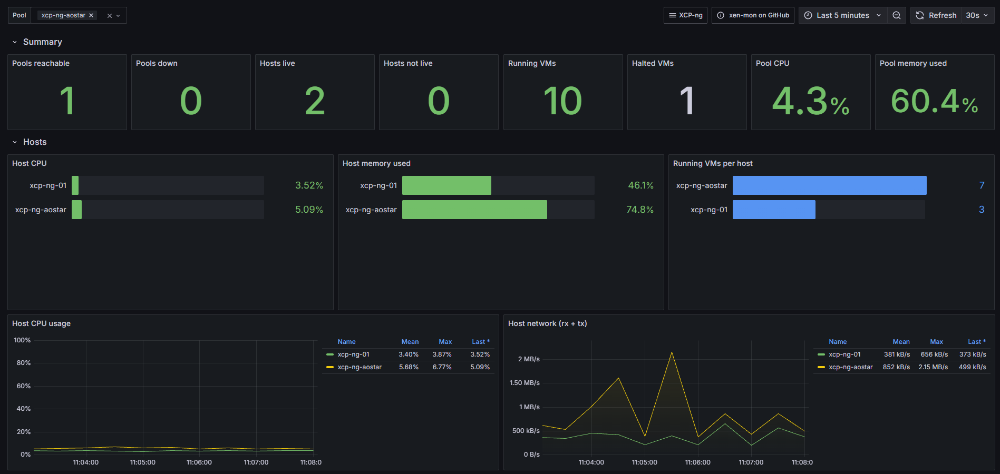
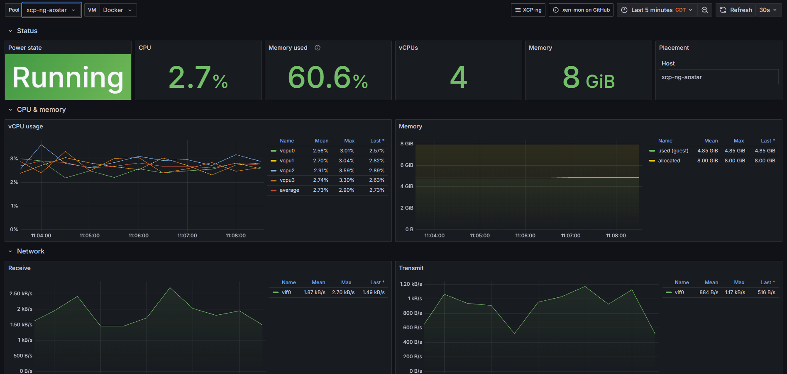

# xen-mon

All-in-one monitoring for **XCP-ng** (and Citrix XenServer) pools: deploy one Docker Compose stack, point it at your pool masters, and get Grafana dashboards and alerts in about a minute.

```
 XCP-ng pools ──XAPI/HTTPS──▶ xen-mon exporter ──▶ Prometheus ──▶ Grafana
 (master + every host)        (:9890 /metrics)      (alert rules)   (3 dashboards)
```



<details>
<summary>VM dashboard</summary>



</details>

- **Agentless.** Nothing is installed on dom0. The exporter logs in to each pool master over the API, discovers every host, VM and SR, and reads the RRD metrics the hosts already record.
- **Multi-pool.** Monitor any number of pools from one stack.
- **Works without Xen Orchestra.** It talks to XAPI directly.
- **Batteries included.** Pre-provisioned Grafana dashboards (Overview, Host, VM) and Prometheus alert rules.

## Deploy

You need a Linux machine or VM with Docker Engine and the Compose plugin (v2.24+). It must be able to reach the management IP of **every** XCP-ng host in your pools on HTTPS (443).

### 1. Get the files

```bash
git clone https://github.com/mspencerl87/xen-mon.git
cd xen-mon
```

### 2. Point it at your pools

```bash
cp config/config.example.yml config/config.yml
cp .env.example .env
```

Edit **`config/config.yml`** and replace `POOL-MASTER-IP` with your pool master's management IP. Use the XCP-ng host itself, not XOA. Add one `- url:` entry per pool:

```yaml
pools:
  - url: https://192.168.10.10
    password: ${XEN_POOL1_PASSWORD}
  # - url: https://10.0.0.20
  #   password: ${XEN_POOL2_PASSWORD}
```

Edit **`.env`** and set the pool password(s) and a Grafana admin password:

```bash
XEN_POOL1_PASSWORD=your-root-password
GRAFANA_ADMIN_PASSWORD=something-strong
```

Instead of steps 2 and 3, you can run `./setup.sh`, which asks these questions and writes both files for you.

### 3. Start it

```bash
docker compose up -d
docker compose logs -f exporter    # wait for: polled N samples ... (up=1)
```

Open `http://<docker-host>:3000` and log in as `admin`. The **XCP-ng Overview** dashboard is the home page.

### Changing pools / starting fresh

The exporter reads `config/config.yml` only at startup. After you edit it, restart the exporter:

```bash
docker compose up -d --force-recreate exporter
```

Old series, such as a renamed pool or a test pool, stay in Prometheus until they age out (`PROMETHEUS_RETENTION`, 30 days by default) and keep appearing in the Pool picker. To wipe all stored metrics and Grafana state and start clean:

```bash
docker compose down -v      # -v deletes the prometheus-data and grafana-data volumes
docker compose up -d
```

### Updating

```bash
git pull
docker compose pull
docker compose up -d --build
```

### Troubleshooting

Start with the built-in check. It logs in to each pool, measures clock skew and fetches performance data from every host:

```bash
docker compose exec exporter python -m xen_exporter.diagnose
```

| Symptom | Cause / fix |
|---|---|
| Every panel says *No data* and *Pools reachable* is 0 | The exporter isn't running. Check `docker compose logs exporter`. "No pools configured" means `config/config.yml` is missing. |
| *Pools down* is 1 | The exporter can't log in. Check the IP, username and password, and whether the Docker host can reach the master on 443. |
| Memory, VM counts and SR usage work, but CPU, network, disk and SR I/O are *No data* everywhere | Often the exporter's clock is ahead of the hosts' clocks, so it asks them for data "from the future" (common on WSL2 or VMs after sleep). Since v0.2 this is compensated automatically and logged as `clock skew`. Fix NTP on both sides anyway. |
| A host shows Memory/VMs but CPU and Load are *No data*, and the Host page shows *Performance data: FAILING* | The exporter can reach the master but not that host's `/rrd_updates`. The log line `rrd_updates from <host> failed` gives the reason. Fix routing, or map the host to a reachable address with `host_overrides`. |
| The Pool picker shows a URL instead of a name | The pool has no name in XCP-ng. Set one in XO, or set `name:` in `config.yml`. |

## Configuration

`config/config.yml`:

```yaml
interval: 30
defaults:
  username: root
  verify_ssl: false
pools:
  - url: https://192.168.1.10          # pool master (a member works too: it redirects)
    password: ${XEN_POOL1_PASSWORD}    # expanded from .env
  - url: https://10.0.0.20
    name: lab                          # optional display name (defaults to pool name)
    password_file: /run/secrets/lab
    host_overrides:                    # if hosts aren't reachable at their XAPI address
      xcp-lab-02: 10.0.0.22
```

For a single pool you can skip the file and set `XEN_URL`, `XEN_USERNAME` and `XEN_PASSWORD` in `.env` (`XEN_URL` accepts a comma-separated list).

| `.env` variable | Default | Purpose |
|---|---|---|
| `GRAFANA_ADMIN_PASSWORD` | `admin` | Grafana admin password |
| `GRAFANA_PORT` | `3000` | Grafana port |
| `PROMETHEUS_BIND` / `PROMETHEUS_PORT` | `127.0.0.1` / `9090` | Prometheus UI (local only by default) |
| `PROMETHEUS_RETENTION` | `30d` | How long metrics are kept |
| `XEN_MON_VERSION` | `latest` | Exporter image tag |

### Credentials

XAPI only offers role-based access for external (AD/LDAP) users. If your pool uses external authentication, create a user with the **read-only** role for xen-mon. Otherwise use `root` and keep `.env` readable only by you (`setup.sh` sets mode 600).

### Network

The exporter needs to reach:
- the **pool master** on 443 for the API, and
- **every host** on 443 for `/rrd_updates`. Each host only reports itself and the VMs running on it.

If a host's address isn't reachable from the Docker host, its panels stay empty and the `XenHostMetricsMissing` alert fires. Fix routing or use `host_overrides`.

## What you get

**Dashboards** (Grafana folder *XCP-ng*):
- **Overview:** pool and host health, VM counts, host CPU and memory, SR usage, latency, IOPS and throughput, top 10 VMs by CPU, memory, network and disk. Click a host or VM to drill down.
- **Host:** per-core CPU, load, memory, dom0 memory, network per PIF, per-SR I/O from that host, and the VMs on it.
- **VM:** vCPU usage, guest memory, and network and disk per device (throughput, IOPS, latency).

**Alerts** (`prometheus/rules/xen.yml`): pool unreachable, exporter down, host not live or disabled, missing host metrics, host CPU above 90%, host memory below 5% free, SR above 85% or 95% full, SR latency above 50 ms, dom0 memory above 90%. You can view them in Prometheus (`http://localhost:9090/alerts`) or in Grafana's alerting UI. To get notifications, add Alertmanager or set up Grafana contact points.

### Metrics

All metrics are prefixed `xen_` and labelled with `pool`, plus `host`/`host_uuid`, `vm`/`vm_uuid`/`is_dom0` or `sr`/`sr_uuid` as appropriate.

| Source | Examples |
|---|---|
| Inventory (XAPI) | `xen_up`, `xen_host_live`, `xen_host_enabled`, `xen_host_memory_{total,free}_bytes`, `xen_vm_running`, `xen_vm_vcpus`, `xen_sr_{size,used,allocated}_bytes`, `xen_*_info` |
| Host RRD | `xen_host_cpu_usage{cpu}`, `xen_host_cpu_avg`, `xen_host_loadavg`, `xen_host_pif_{rx,tx}_bytes{pif}`, `xen_host_sr_{iops_read,iops_write,io_throughput_read,latency,iowait,...}{sr}` |
| VM RRD | `xen_vm_vcpu_usage{vcpu}`, `xen_vm_memory`, `xen_vm_memory_internal_free` (KiB, needs guest tools), `xen_vm_vif_{rx,tx}_bytes{vif}`, `xen_vm_vbd_{read,write}_bytes{device}`, `xen_vm_vbd_{read,write}_latency` (µs) |

Any other RRD data source is exported as `xen_host_<name>` or `xen_vm_<name>`, so nothing is dropped. Units follow XAPI: CPU is a 0–1 fraction, network and disk are bytes/s, SR throughput is MiB/s, and SR latency is in ms.

### Using only the dashboards

Already running Prometheus? Run just the exporter, add a scrape job for `<exporter>:9890`, and import the dashboards from [`grafana/grafana.com/`](grafana/grafana.com). Those copies ask which Prometheus datasource to use when you import them.

## Development

```bash
cd exporter
pip install -r requirements.txt pytest
python -m pytest -q tests                     # unit tests + end-to-end against a fake pool
(cd tests && MOCK_HOSTS=127.0.0.1,localhost MOCK_PORT=18080 python mock_xapi.py &)   # fake pool
XEN_CONFIG=/none XEN_URL=http://127.0.0.1:18080 XEN_PASSWORD=demo python -m xen_exporter
curl -s localhost:9890/metrics | grep ^xen_ | head
```

The dashboards are generated by `tools/gen_dashboards.py`. Edit that file and re-run it rather than editing the JSON by hand. CI checks that the generated JSON is current, and pushes multi-arch exporter images to `ghcr.io/mspencerl87/xen-mon-exporter`.

## Roadmap

- Bundled Alertmanager with email, Slack and Teams examples
- Optional Xen Orchestra OpenMetrics source (backups, patches)
- Pending-patch and HA status metrics
- Helm chart

## License

MIT
